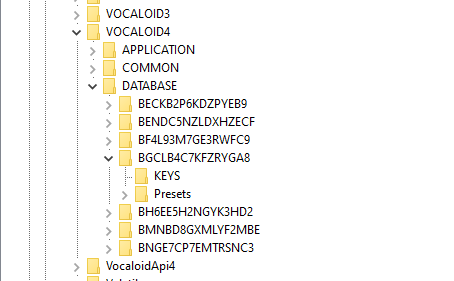
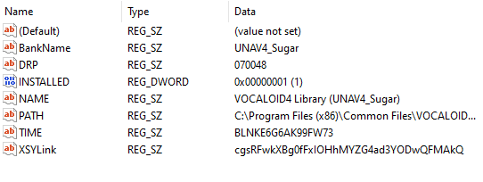

# About the Registry Editor

!!! danger "Author's warning"
    **Please proceed with extreme caution.**

This section is meant to serve as a point of reference for those that want to go even further
with voice database installation and registration.

The Windows Registry is used across all versions to store and manage information. This includes G2PA
management, voice database information, voice database activation/authorization, and the list continues.



If you wish to write your own .reg files in order to install a database, or simply want to customize a key,
but are unsure of how things work, you may refer to this entry.

## About Registry Paths (64bit only)

Typically, you will find the keys for versions bellow V5/6 in
```Computer\HKEY_LOCAL_MACHINE\SOFTWARE\WOW6432Node```; while keys for V5 and/or 6 will simply
be in ```Computer\HKEY_LOCAL_MACHINE\SOFTWARE```.

As an example, this is the path to the key for V4 : ```Computer\HKEY_LOCAL_MACHINE\SOFTWARE\WOW6432Node\VOCALOID4```

Of course, the keys you'll find in your Registry will depend and vary based on what you've installed on your system. 

!!! danger "Author's note"
    Registry keys are containers that behave similarly to folders. They contain String values,
    Binary values, and other necessary data for your Editor as well as Voicebanks.

## About Key Structures and values

Quick introduction to various Registry values :

>Default Value : The key’s default value.

>String Value : A fixed-length text string.

>Binary Value : The value is interpreted and stored as a hexadecimal value.

>DWORD Value : Data represented by a number that is four bytes (32 bits) long.

>Multi-String Value : Multiple text strings formatted as an array of null-terminated strings,
and terminated by two null characters. Selecting this command launches the Multi-Line String Value dialog box.

>Expandable String Value : The value is interpreted and stored as an expandable string.
An expandable string registry value is a null-terminated string that contains unexpanded
references to environment variables (for example, %PATH%).

When working in your Windows Registry, you should be able to recognize the following :

>Bankname

>DRP

>NAME

>PATH

>TIME

!!! danger "Author's note"
    You don't need to worry about XSYLink and INSTALLED.




The following is a break-down of what each value manages :

>Bankname  : This string indicates what your databases' name will be inside of the Editor.  As simple as it sounds.

>DRP  : The core component of a database Component ID. This indicates and tells the Editor what your voicebanks vendor number,
product number and language are. For better understanding, view the CompID graph attached in the first entry of this tab (Compiling a database / Component IDs).

>NAME  : DO NOT confuse this with Bankname ! They are not the same. This string indicates your
voicebanks' full name. This is also how it will appear in Authorizers.

>PATH  : Another simple string. Very self explanatory, it tells the Editor where your voicebank is located on your system,
however it is crucial. A wrong PATH can cause it to be unable to read your database and it will simply exclude and not display it in the Editor.

>TIME  : This determines the date the product was installed on the users system. They are formatted similarly to Component IDs, however they are not one and the same.
For example, this is a TIME string with the date 2025/07/18 : BLHMC6C884R3DDBL - Decoding this results : 00004000250718. As you may already be able to tell, the 
last 6 digits are a Japanese date (YY/MM/DD).